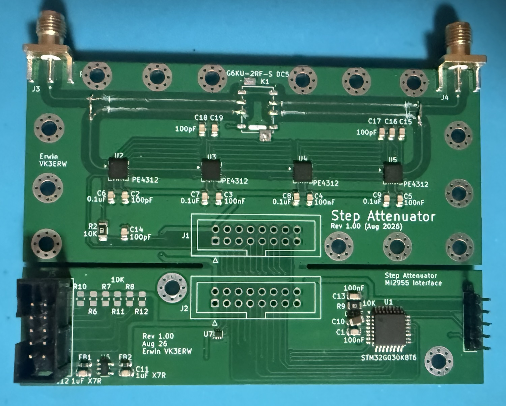
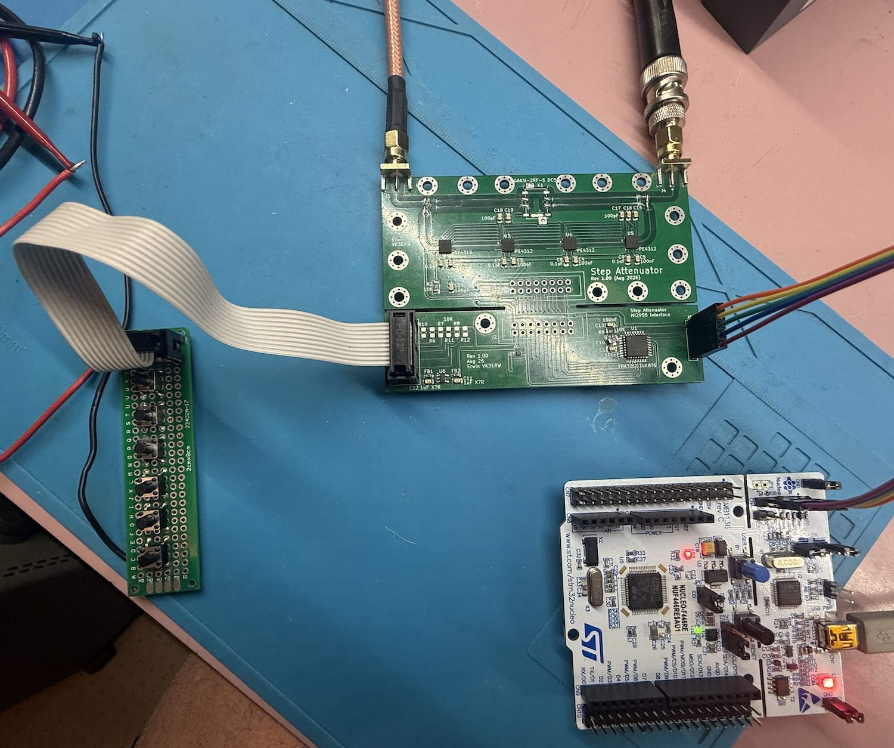
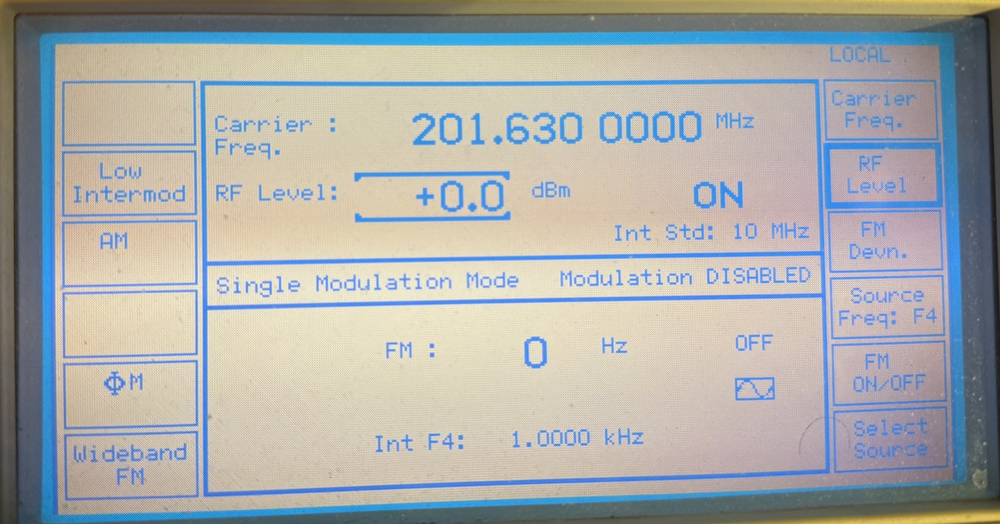
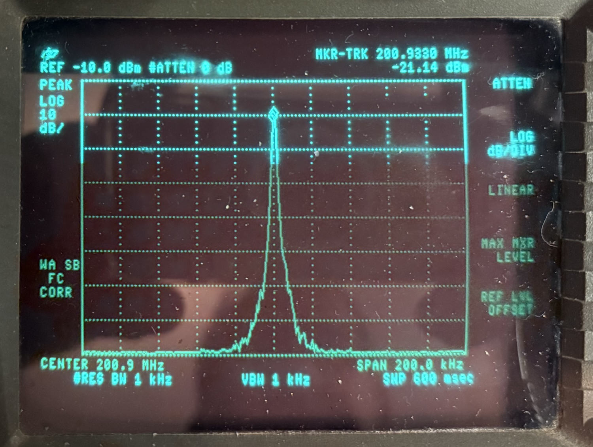
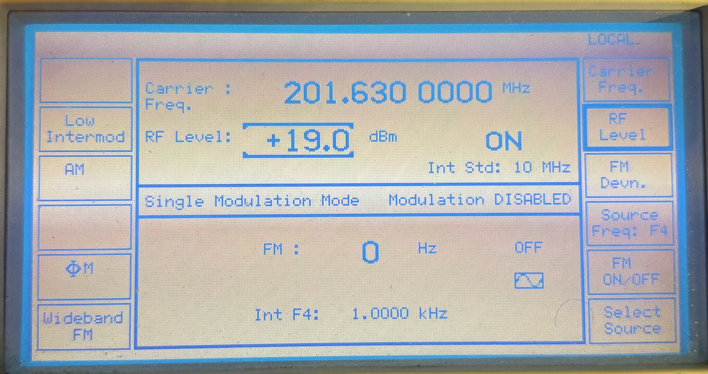
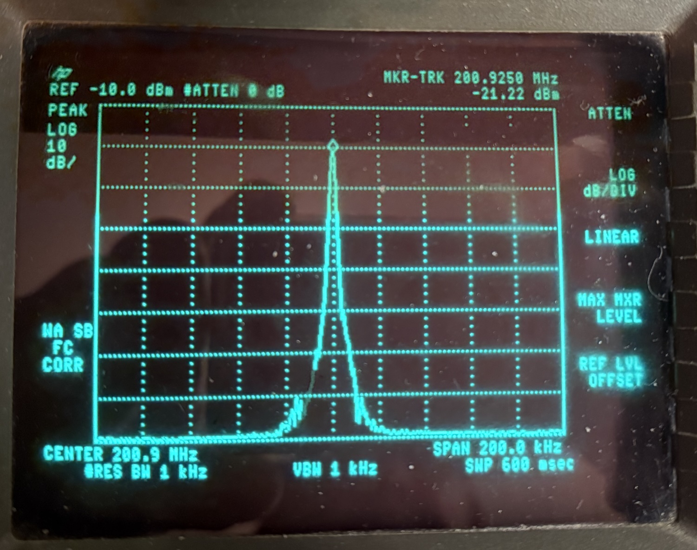
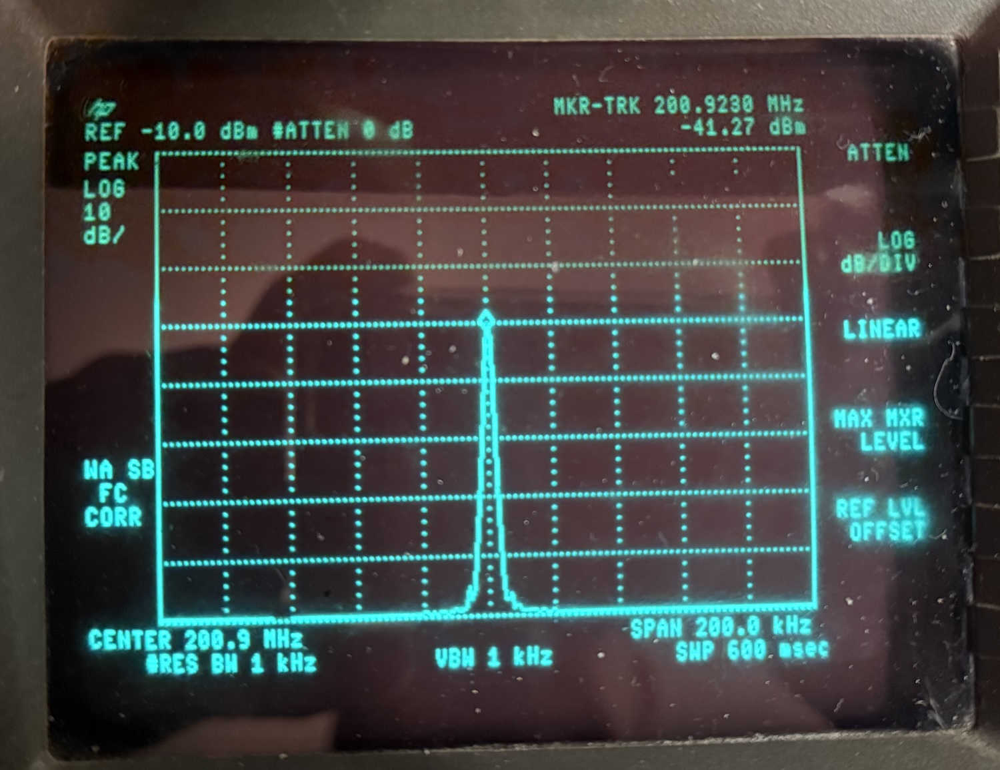
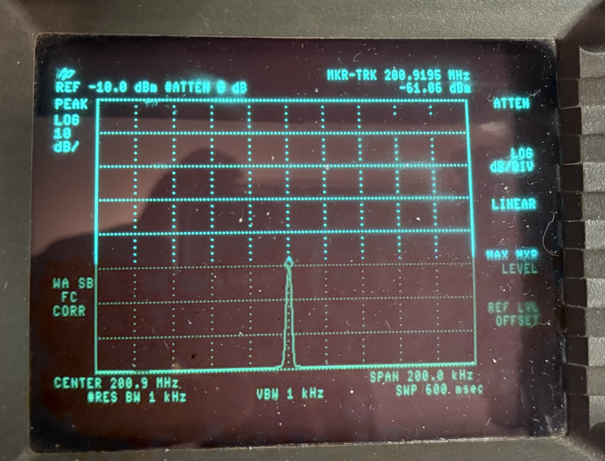
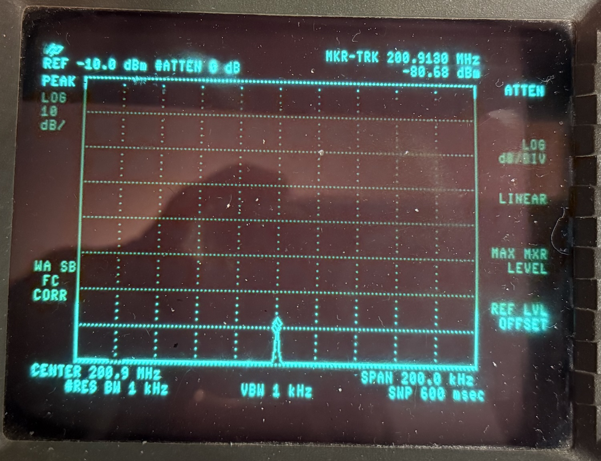

# Step Attenuator (V1)
### Performance Test 20 Nov 2026

This first prototype design was found lacking with attenuation settings above 40dB. The cause of this is the RF leakage through the bypass relay which is only rated to 30dB isolation. PCB design also needs to be improved. 

The following steps were taken to overcome RF leakage issue:

- Bypass relay removed for board
- RF tracks between relay and SMA connectors and PE4312 were cut and a wire soldered in place to shorten the RF tracks

The modified board:

The modified board is not suitable for the intended use in the MI2955 due to the insertion loss of nearly 6dB which is too much for the MI2955 to compensate via calibration. Hence the following tests do not include a 0dB setting which was intended to trigger the [now removed] bypass relay

Test setup:

RF input is conencted to a Marconi 2030 Signal Generator. RF Output is conencted to a HP8590A Spectrum Analyser which is off frequency, so ignore the frequency readout.

A set of 6 push buttons are simulating the control signals.

The following tests are performed at 200MHz to overcome the RF leakage issues inherent in the board design. Increasing the frequency to 1GHz brings out the RF leakage and restricts the board to 40dB controllable attenuation.

---
# Test Results

### Test 1

Sig Gen setting (0dBm):
 

Result at 20dB setting: (-21.6dB):
 

### Test 2

Sig Gen setting (+19dBm):
 

Result at 40dB setting: (-40.2dB):
 

### Test 3

Sig Gen setting +19dBm

Result at 60dB setting: (-60.2dB):
 

### Test 4

Sig Gen setting +19dBm

Result at 80dB setting: (-80.0dB):
 

### Test 4

Sig Gen setting +19dBm

Result at 100dB setting: (-100.7dB):
 

---
