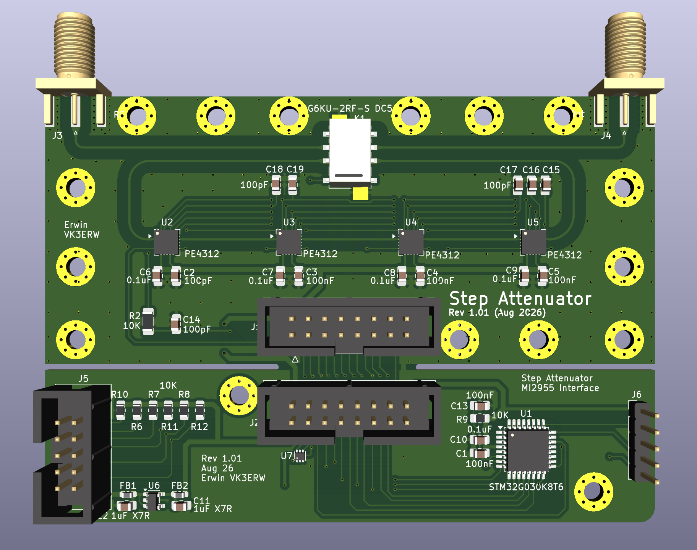
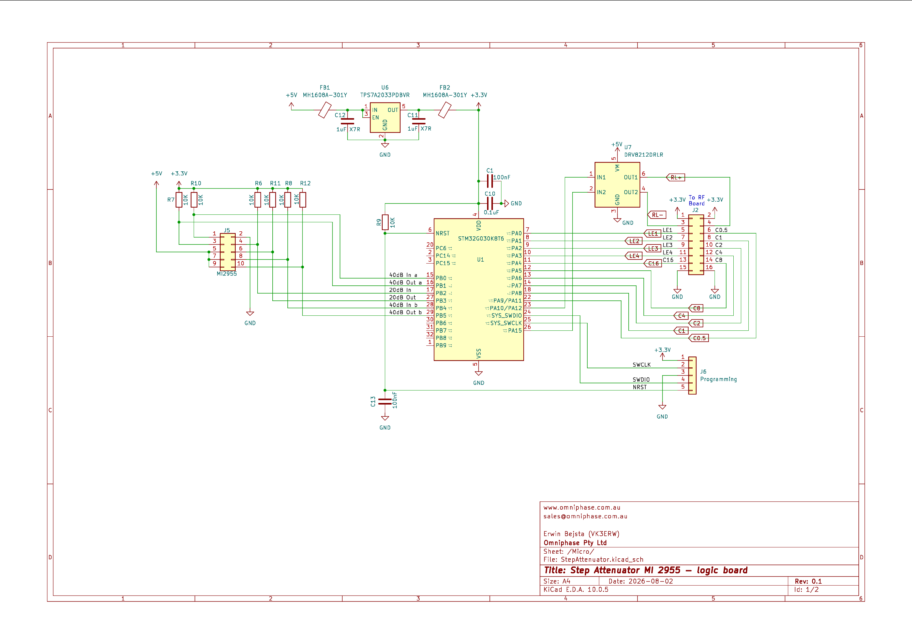
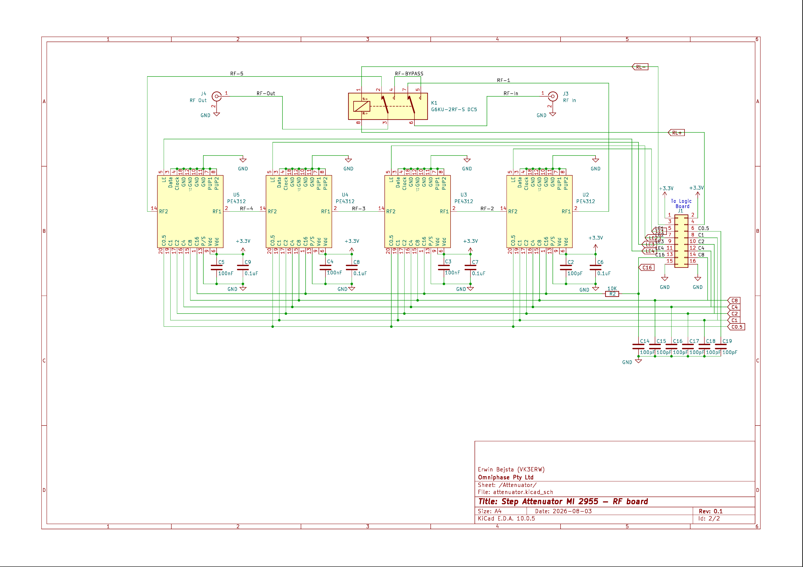

# StepAttenuator
### Step Attenuator for Marconi 2955

To replace the original electro-mechanical Step Attenuator which suffers from wear of electro-mechnical components. 

The board is mechanically compatible with the original Marconi step attenuator 

The MCU is normally in deep sleep mode (no clock) to prevent interference. It only wakes up when the MI2955 issues a command to change the attenuation setting.

The board design allows for the MCU section to be separated from the attenuator to be located in a different housing if desired.

The PE4312DS attenuator pads specifiy insertion loss of 1.3dB. With all pads at 0dB the total loss of the board is expected to be around 5dB. To achieve the 0dB setting of the attenuator a RF relay bypassed all attenuator pads.

[Circuit PDF](Doc/StepAttenuatorCircuit.pdf)

